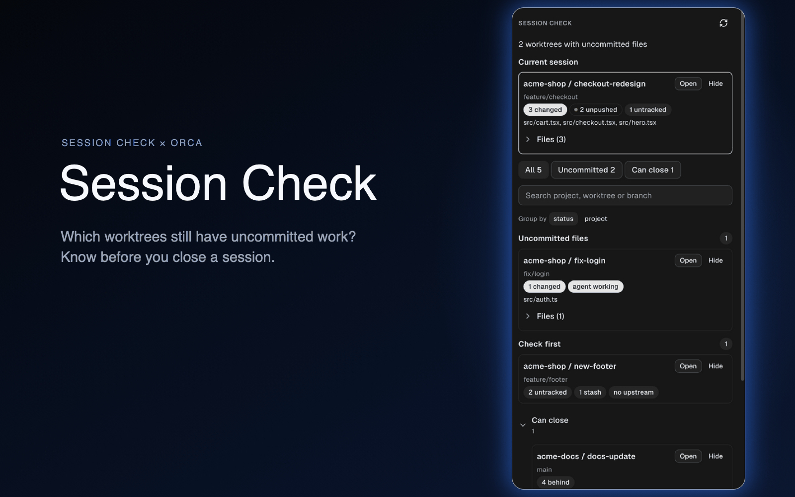
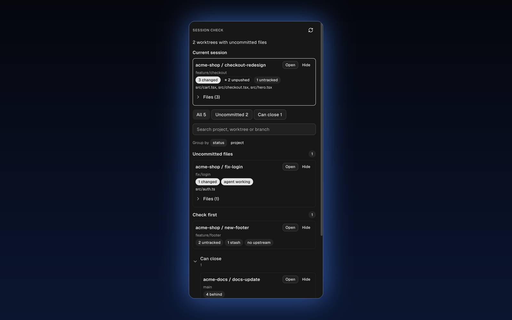
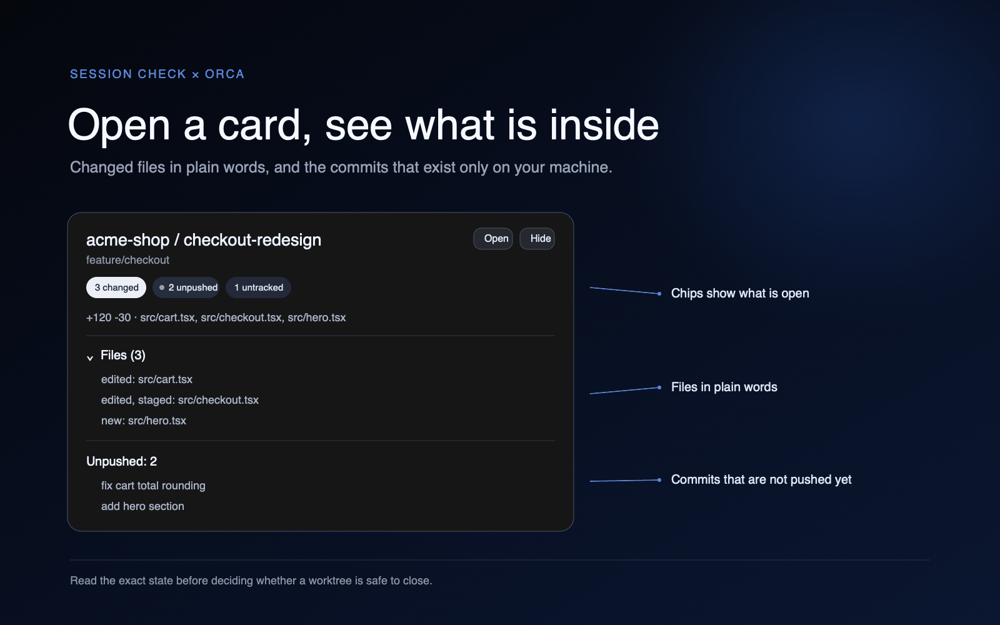
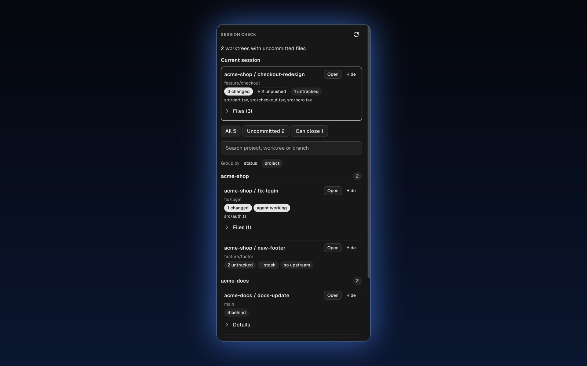
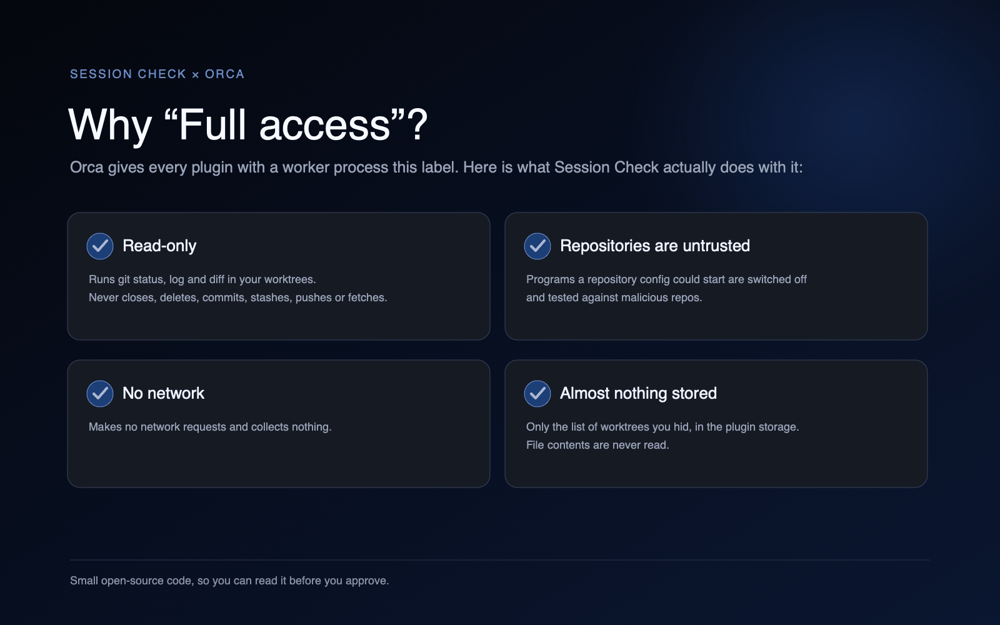

# Session Check for Orca: know which sessions still have open work

An [Orca](https://github.com/stablyai/orca) plugin that shows, for every local worktree, its **uncommitted files, unpushed commits, stash entries and running agent**, and tells you which sessions you can close and which you should keep open.



## Why

After a day with several agents you have a dozen worktrees open and no idea which of them still hold work that exists nowhere else. Closing the wrong one loses it. Session Check reads the git state of every worktree and shows you the facts, so you can close the clean ones and finish the others.

## What you get

- **Current session on top:** the workspace you are in is pinned above the list, whatever filter or search is set.
- **Uncommitted files first:** a short line says how many worktrees have uncommitted files, and the list is grouped into *Uncommitted files* (most files on top), *Keep open*, *Check first*, *Can close* and *Not checked*.
- **One compact card per worktree:** project, branch and chips such as `14 changed`, `13 unpushed`, `agent working`, `3 untracked`, `1 stash`, `merged` or `clean`. Red is only for conflicts, a running merge or rebase and files named like secrets, so the panel stays calm.
- **Size and age at a glance:** `+120 -30` lines, the first changed files, the oldest uncommitted change, the last commit and the last activity Orca saw. Forgotten sessions stand out.
- **Details on demand:** the first 20 changed files in plain words (`new`, `edited`, `deleted`, `renamed`, `conflict`) and the subjects of the first three unpushed commits.
- **Search, filter, group:** by project, worktree or branch; uncommitted or closable only; by status or by project. Your choices are remembered.
- **Open and hide:** *Open* jumps to the worktree in Orca. *Hide* only removes it from the list, and a hidden worktree comes back as soon as it gets worse than it was.
- **Status bar count:** `Sessions 3 open` or `Sessions ok` in Orca's status bar, without opening the panel. Hidden worktrees do not count, and a worktree that could not be checked never counts as ok (`Sessions ?` when none could be checked). The tooltip names the five worktrees with the most uncommitted files. Clicking it rescans.
- **Agent finished, work left:** a desktop notification such as `acme-shop / checkout: agent finished, 3 files uncommitted` when an agent stops and its worktree still has uncommitted files, new files or unpushed commits. At most one per worktree every 10 minutes, never for hidden or clean worktrees, and you can switch it off.
- **Files that must not be committed:** a red chip such as `1 sensitive file` or `1 secret in repo` when a worktree has a `.env`, a private key, a password database or a credentials file that git does not ignore, or that is tracked already, and an amber `junk files` chip for `node_modules`, `.DS_Store` and new archives or dumps. The card lists them under *Do not commit* as `.env (not ignored)` or `deploy/prod.pem (already tracked)`. Judged by the **file name only**, see [Sensitive files](#sensitive-files).
- **Pull requests, if you want them:** turn on *Show pull requests* and each card gets a chip such as `PR #12 open`, `PR #12 draft`, `PR #38 merged` or `PR #9 closed`. It tells what git alone cannot: a branch merged with squash looks unmerged to git, and a pushed branch still in review looks closable. The chip never changes the verdict. Off by default, because it is the plugin's only use of the network, see [Privacy and access](#privacy-and-access).
- **English, German, Spanish:** the panel, the status bar and the notification follow Orca's language, or the one you pick in the settings. Names, branches and file paths are always shown as they are.
- **Facts only:** it never closes, deletes, commits, stashes, pushes or fetches anything, and never reads file contents.

## See it

**Which sessions have open work.** The current session on top, then worktrees grouped by status.



**Open a card.** Changed files in plain words, and the commits that exist only on your machine.



**See it without opening the panel.** The status bar count and the notification when an agent leaves work behind.


**English, Deutsch, Español.** The panel follows Orca's language or the one you pick in the settings.


**One project at a time.** The same list grouped by project.



**Light theme.** It follows Orca's theme.


## The verdicts


| Verdict | Meaning |
|---|---|
| **Keep open** | a file named like a secret that is not ignored (it would go into the next `git add .`), uncommitted or conflicted files, unpushed commits, an agent working or waiting for you, a detached HEAD with commits no base branch holds, or a merge, rebase, cherry-pick, revert or bisect in progress |
| **Check first** | junk files (`node_modules`, `.DS_Store`, new archives), a secret that is already tracked, only untracked files, stash entries, a branch without upstream that has commits outside the base branch, a deleted upstream, a detached HEAD without own commits, or submodules (their changes are not looked at) |
| **Can close** | clean, nothing unpushed (or every commit is already in the base branch), and no active agent |
| **Not checked** | folder workspace, remote (SSH) workspace, partial clone, not a git repository, git missing or failing. The reason is shown, nothing is guessed |

When in doubt it is stricter: a worktree is never shown as closable because something could not be read.

## Sensitive files

Session Check looks at the **names** git already gives it: every new file that is not ignored and every changed file (from `git status`, all of them, not only the 20 shown), and every tracked file (from `git ls-files`, the same call that finds submodules). Git never lists ignored files, so a `.env` in your `.gitignore` is not reported. File contents are never read.

| Kind | Name (case does not matter) | Notes |
|---|---|---|
| Secret | `.env`, `.env.*` (`.env.local`, `.env.production`, ...) | |
| Secret | `*.pem`, `*.key`, `*.p12`, `*.pfx`, `*.ppk`, `*.jks`, `*.keystore` | private keys and key stores |
| Secret | `id_rsa`, `id_dsa`, `id_ecdsa`, `id_ed25519` (also `id_rsa.bak` and the like) | SSH private keys; the `.pub` files are fine |
| Secret | `*.kdbx` | KeePass databases |
| Secret | `credentials.json`, `client_secret*.json`, `service-account*.json`, `serviceaccount*.json`, `firebase-adminsdk*.json`, `.aws/credentials`, `.docker/config.json` | cloud credentials |
| Secret | `.npmrc`, `.pypirc`, `.netrc`, `.htpasswd`, `.git-credentials`, `.pgpass`, `auth.json` | often hold tokens or passwords |
| Secret | `secrets.yml`, `secrets.yaml`, `secrets.json`, `wp-config.php` | |
| Secret | `*.tfstate`, `*.tfstate.backup`, `*.tfvars`, `*.tfvars.json` | Terraform state and variables |
| Not a secret | any name ending in `.example`, `.sample`, `.template`, `.dist`, `.defaults` or `.tmpl` | templates are meant to be committed (`.env.example`) |
| Junk | a `node_modules` folder anywhere in the path | |
| Junk | `.DS_Store`, `Thumbs.db` | |
| Junk | `*.zip`, `*.tar.gz`, `*.sql`, `*.dump` | only while they are new (untracked) |

A secret that is not ignored makes the worktree **Keep open** (it cannot be hidden, and a hidden one comes back). A secret that is already tracked and junk make it **Check first**, so a committed test certificate does not block the list for ever. A tracked junk file is not reported, and a folder git lists as a whole is only checked against the folder rules (a Python virtualenv named `.env/` is not a secret).

Limits, so you know what this is and what it is not:

- **Names only.** An API key written into `config.ts` or a README is **not** found. This is a reminder, not a secret scanner.
- Patterns can give **false alarms**: a test certificate `fixtures/test.pem`, a committed `.npmrc` with no token in it, or a `wp-config.php` that reads everything from the environment all count. Add the file to `.gitignore`, rename it, or switch the warning off in the settings.
- A new folder that git lists as one entry (`config/`) is not looked into, so a `.env` inside a brand new folder shows up only once the folder is partly tracked or git lists its files.
- A secret that was committed and then deleted is still in the history. Session Check only looks at the files of the worktree now.

## Install

Requires Orca 1.4.259 or newer and `git` in your `PATH`. Tested with git 2.42 and newer.

1. In Orca, open **Settings → Plugins**.
2. Add the marketplace `https://github.com/stablyai/orca-community-plugins.git` (ref `main`).
3. Search for **Session Check**, install it and approve the access.

From source: `git clone https://github.com/brodesigns/orca-session-check`, then `orca plugin dev load .` in the folder.

## Settings

| Setting | Default | |
|---|---|---|
| Base branch | empty | Branch that counts as "already merged", for example `origin/main`. Empty detects it from `origin/HEAD`. |
| Refresh interval | 30 s | How often the open panel rescans (10 to 300 seconds). |
| Background refresh | 120 s | How often the status bar count is refreshed while the panel is closed (30 to 600 seconds, `0` = off). Agent and workspace changes rescan the workspace concerned either way. |
| Notify when an agent finishes | on | The desktop notification described above. |
| Warn about sensitive files | on | The chips, the *Do not commit* list and the verdict for [sensitive files](#sensitive-files). Off, no file is reported and the verdict ignores names. |
| Show pull requests | off | A chip with the state of each branch's GitHub pull request. Asks the GitHub CLI `gh`, which must be installed and logged in, at most every 5 minutes per worktree. See [Privacy and access](#privacy-and-access). |
| Language | Automatic | `Automatic` follows Orca's language (English when it is none of the three), or pick English, Deutsch or Español. |

The worker rescans on its own: once shortly after Orca starts, when an agent or a workspace changes (only the workspace concerned), and on the background refresh. A workspace is read again on its own account at most every 15 seconds, and at most 4 repositories are read at the same time.

## Privacy and access

Orca labels every plugin with a worker "Full access". Here is what this one does with it:



- reads your workspace list (names, branches, paths, agent status) and gets notified when workspaces or agents change
- uses the **workspace write** permission only for one call, `workspace.open`, when you press **Open**. Orca's wording for that permission is broader (it also covers renaming workspaces and similar), the plugin calls nothing else.
- runs the system tool `git` in your local worktrees with fixed arguments, read-only (`status`, `stash list`, `log`, `diff --shortstat`, `ls-files` for names and modes, `rev-parse`, `symbolic-ref`, `merge-base`, `config` to list names and, with pull requests on, the remote URLs). It never uses a shell, never fetches or pushes, and passes only a short list of environment variables (`PATH`, `HOME`, ...).
- treats every repository as untrusted. A repository's own config can make git start programs, so the plugin switches off `core.fsmonitor`, hooks, `log.showSignature` (gpg) and every network protocol (a partial clone would fetch missing objects on its own), sets `GIT_NO_LAZY_FETCH`, skips partial clones, ignores the worktree's `.gitattributes`, and empties every `filter.*.clean`, `smudge` and `process` command the repository defines. Tests with malicious repositories prove that these programs do not run, and that they do run when git is called without this protection. Two independent security reviews found issues, all fixed and tested.
- stops git after 8 seconds or 2 MB of output, runs at most 4 repositories at the same time and checks at most 100 workspaces
- rescans in the background while Orca runs (see Settings), with the same fixed git calls and limits; set the background refresh to `0` to keep only the event-driven rescans
- uses the **notifications** permission only for the "agent finished" notification. It contains the project and worktree name (cleaned of control characters and cut to 40 characters) and counts (including the number of sensitive files), never file names or file contents. The status bar item shows the same kind of text.
- makes no network requests unless you turn on *Show pull requests*, and collects nothing. With it on, it starts `gh pr list` for each local worktree whose remote is on github.com, at most every 5 minutes per worktree. `gh` runs outside the worktree with `--repo`, so the repository's config never reaches it, and gets only the variables it needs to find its login. Only the number and the state of the pull request are kept, in memory.
- judges sensitive files by their **names only**, as git lists them. It never opens a file, so a file nobody may read is reported all the same (a test proves it with an unreadable `.env`).
- reads the time of the last commit and the first unpushed commit subjects (`git log`), the size of your changes (`git diff --shortstat`, with textconv and external diff switched off) and the modification time of changed files (`lstat`, no symlinks followed, no contents)
- stores only the list of worktrees you hid, in the plugin's own storage, and its settings

## Good to know

- Unpushed and behind counts use the **last known** upstream. Nothing is fetched, so run `git fetch` yourself for fresh numbers.
- "Already in the base branch" compares with the remote-tracking branch `origin/HEAD` (or `origin/main`, `origin/master`, or the base branch you set). A local branch never counts as the base.
- Git shares one stash between all worktrees, so stash entries are counted per branch.
- Filters such as Git LFS are not run, and the `.gitattributes` of the worktree is ignored (a repository must not be able to start a program through it). So LFS files and files with an `eol` attribute can show up as modified when only their time stamp changed. That is the stricter side.
- Workspaces on other hosts (SSH) and partial clones are listed as "not checked".
- A pull request is looked for where `gh` itself looks: in the remote chosen with `gh repo set-default`, else in `upstream`, `github` or `origin`, opened under the branch's name from the remote it tracks (or `origin`). So a pull request from your fork to the original repository is found too. github.com only, not GitHub Enterprise.

<details>
<summary>How it works, develop</summary>

The git logic is in `src/git.ts` (pure functions: arguments, parsers, verdict). `src/runner.ts` is the only place that starts git, `src/gh.ts` the only one that starts `gh` (and only with the pull request setting on). `src/worker.ts` scans, answers the panel, updates the status bar and sends the notification, `src/summary.ts` builds their text, `src/sensitive.ts` holds the name rules for sensitive files, `src/chips.ts` turns the numbers into chips and groups, `src/i18n.ts` holds every text in English, German and Spanish, `src/panel.tsx` draws it. About 2,200 lines of code in `src/`, plus tests that run against real temporary git repositories, including malicious ones.

```bash
orca plugin types .       # write the typings to .orca/
orca plugin test .        # unit tests
orca plugin validate .
orca plugin dev watch .   # load into Orca and stream logs
```

</details>

Made by [BroDesigns](https://brodesigns.de). MIT, see [LICENSE](LICENSE).
